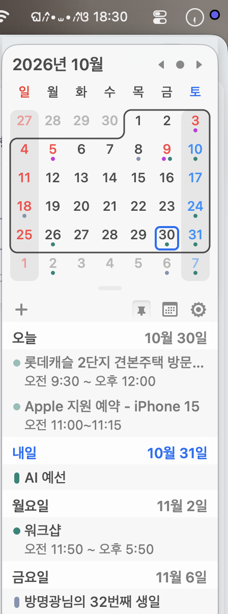
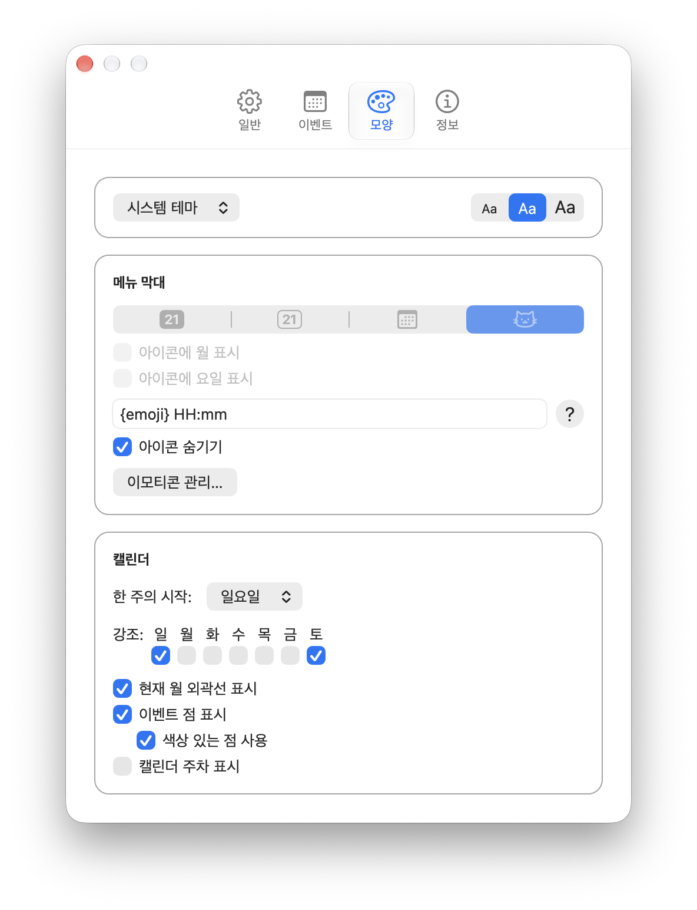
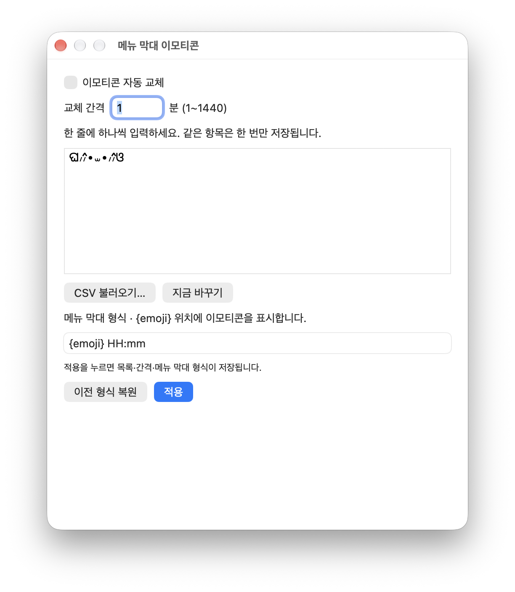

# KawaiiCal 🐱

고양이와 함께 쓰는 macOS 메뉴 막대 캘린더입니다. [Itsycal](https://github.com/sfsam/Itsycal)을 기반으로 한국어 표시와 개인화 기능, UI를 다듬었습니다.

현재 버전은 **0.1.0**이며, **Apple Silicon · macOS 27 이상**을 대상으로 합니다.

## 스크린샷

**메뉴 막대** — 이모티콘과 시간을 함께 표시합니다.


**캘린더와 일정 목록** — 한국어 날짜와 주말·공휴일 색상을 확인할 수 있습니다.



**모양 설정** — 테마, 글자 크기, 메뉴 막대와 캘린더 표시를 설정합니다.



**이모티콘 관리** — 목록과 교체 간격을 설정하거나 CSV를 불러올 수 있습니다.



## 주요 기능

- 한국어 날짜·시간 표시와 설정 화면
- 토요일은 파란색, 일요일과 지정한 공휴일은 빨간색으로 표시
- 캘린더별 공휴일 지정: 해당 캘린더에 등록된 일정의 날짜에 공휴일 색상 적용
- 메뉴 막대 이모티콘·카오모지 목록 관리, CSV 가져오기, N분 간격 랜덤 로테이션
- 시스템 재질을 적용한 팝업, 조정된 일정 목록과 설정 화면
- 고양이 앱 아이콘과 밝고 어두운 배경에 대응하는 단색 메뉴 막대 아이콘
- macOS 캘린더와 연동한 일정 조회·생성·삭제

공휴일 데이터는 자동으로 구독하지 않습니다. macOS 캘린더에 추가된 대한민국 공휴일 캘린더 등을 설정의 이벤트 탭에서 공휴일 캘린더로 지정해 주세요.

## 설치

[0.1.0 릴리스에서 공증된 앱 내려받기](https://github.com/ynifamily3/kawaiiCal/releases/tag/v0.1.0)

1. `KawaiiCal-0.1.0-arm64.zip`을 내려받고 압축을 풉니다.
2. `KawaiiCal.app`을 응용 프로그램 폴더로 옮겨 실행합니다.
3. 캘린더 접근 권한을 허용합니다.

Apple Silicon Mac과 macOS 27 이상이 필요합니다. 앱은 Developer ID로 서명하고 Apple 공증을 완료했습니다.

## 직접 빌드하기

Xcode 27과 Command Line Tools가 필요합니다.

```sh
git clone https://github.com/ynifamily3/kawaiiCal.git
cd kawaiiCal
./scripts/build.sh
```

결과물은 `outputs/KawaiiCal.app`에 생성됩니다. 기본 설정은 Apple Developer 계정 없이 로컬 실행용으로 서명합니다. 개인 서명 설정은 추적되지 않는 `Local.xcconfig`에서 관리합니다.

앱을 종료한 다음 설치하고 실행합니다.

```sh
./scripts/install.sh
open /Applications/KawaiiCal.app
```

일정을 표시하려면 macOS의 캘린더 접근 권한을 허용해야 합니다. 앱 식별자는 `ing.miel.KawaiiCal`이며 원본 Itsycal과 설정을 별도로 저장합니다. 자동 업데이트는 비활성화되어 있어 업데이트하려면 다시 빌드해야 합니다.

## 서명과 공증

배포용 빌드에는 본인의 Developer ID Application 인증서와 Apple 공증 자격 증명이 필요합니다.

```sh
xcrun notarytool store-credentials kawaii-cal
SIGNING_IDENTITY='Developer ID Application: YOUR NAME (TEAMID)' \
NOTARY_PROFILE=kawaii-cal ./scripts/notarize.sh
```

인증서의 개인 키, 암호, 공증 자격 증명은 저장소에 넣지 마세요. 빌드·설치·공증 및 각 기능의 상세 설명은 [개발 문서](README.personal.md)를 참고하세요. 빌드 결과물은 Git에 포함하지 않으며, 설치용 앱은 [GitHub 릴리스](https://github.com/ynifamily3/kawaiiCal/releases)에서 제공합니다.

## 원본과 라이선스

Itsycal 0.27.3의 커밋 `1a31050555a97e3b7aac5470ec147abfe7aa0d6a`에서 출발했습니다. 원본 프로젝트의 Git 이력과 저작권 고지를 유지합니다. 원본 안내는 [README.txt](README.txt)에 있습니다.

[MIT License](LICENSE.txt). 포함된 타사 프레임워크에는 각 프레임워크의 라이선스가 적용됩니다.
